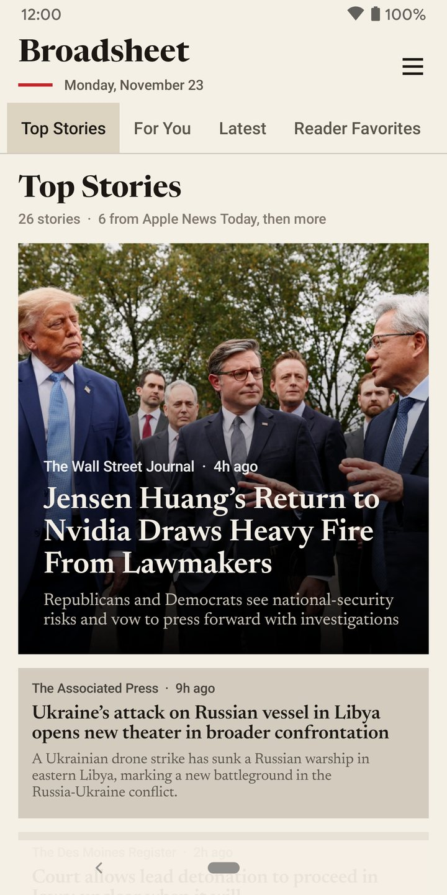
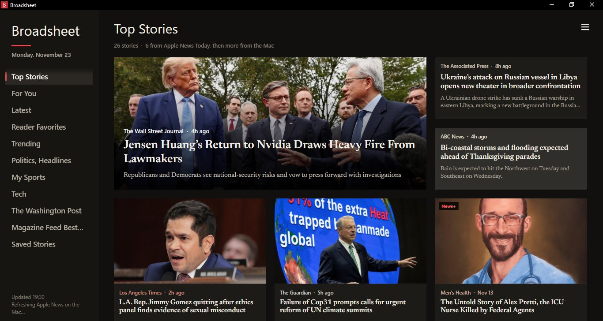
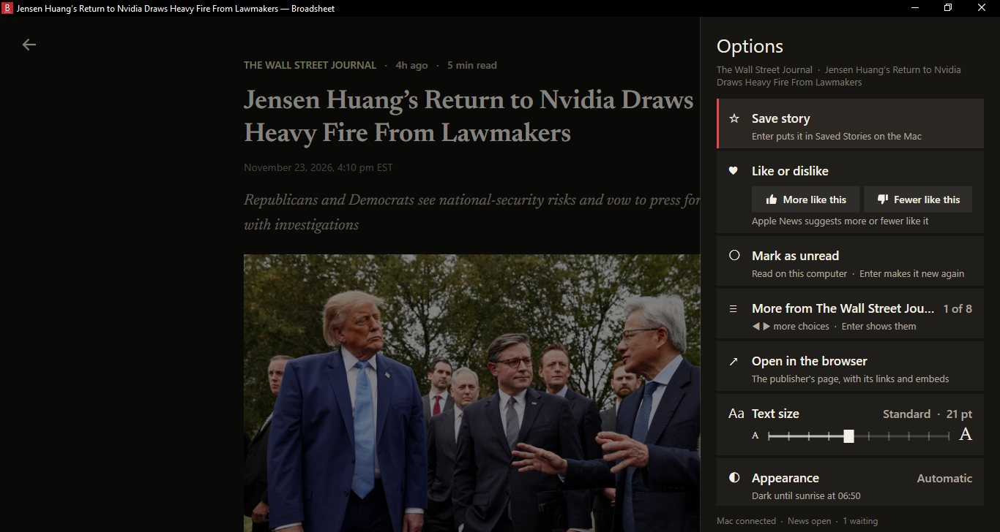

# Broadsheet: Apple News on Android, Fire TV and Windows

**Read Apple News on an Android phone, Fire TV, Android TV, Google TV or a Windows PC.** Apple
News has no Android app, no Windows app and no reader API, so Broadsheet gets your news from a
Mac: [**Apple News Relay**](https://github.com/VladislavEkimtcov/apple-news-relay), a small
server that runs next to the News app and turns it into a local JSON API. Broadsheet shows
your Apple News (Today's Top Stories, For You, Trending, your topics and channels, Saved
Stories) with a newspaper-style front page and a calm serif reader. No ads, no account on the
device, nothing sent anywhere but your own Mac.

**You need a Mac** with Apple News, running Apple News Relay on the same network. Broadsheet
is an unofficial reader; it is not affiliated with Apple.

| Android phone | Fire TV and Android TV | Windows |
|---|---|---|
|  |  |  |

## Downloads

| | Download | Runs on |
|---|---|---|
| Android | [**broadsheet.apk**](https://github.com/VladislavEkimtcov/broadsheet/releases/latest/download/broadsheet.apk) | Android phones and tablets (touch), Fire TV, Android TV, Google TV (D-pad remote): one APK, Android 7.1 or later |
| Windows | [**broadsheet-windows.zip**](https://github.com/VladislavEkimtcov/broadsheet/releases/latest/download/broadsheet-windows.zip) | Windows 10 and 11 (IoT Enterprise LTSC too), .NET Framework 4.8 (built in) |

These links always point at the [latest release](https://github.com/VladislavEkimtcov/broadsheet/releases/latest);
`SHA256SUMS.txt` there has the checksums. Every port carries the same version number.

- **Android:** open the APK on the device. The first time, Android asks to let your browser
  (or file manager) *install unknown apps*: allow it, then *Install*. On a Fire TV, sideload it
  with the *Downloader* app (Settings → My Fire TV → Developer options → Install unknown apps),
  or `adb install -r broadsheet.apk`. Updates install over the old version.
- **Windows:** if Windows blocked the download, right-click the zip → Properties → *Unblock*,
  then unzip and run `powershell -ExecutionPolicy Bypass -File install.ps1` (Start menu entry,
  no admin rights). Running `Broadsheet.exe` directly works too; if SmartScreen says "Windows
  protected your PC", choose *More info* → *Run anyway*.

## Apple News on Fire TV and Android TV

Apple News on Android TV, Google TV and Fire TV: a front page and reader built for the remote: a
rail of sections on the left, a hero, briefs and rows of picture cards, an options panel on the Menu key (save, like or dislike, more from the
publisher, text size from 14 to 40 pt, light by day and dark after sunset), videos in stories,
and *On the Mac*, which carries on with the story open in Apple News on the Mac. Details and
screenshots: [android/README.md](android/README.md).

## Apple News on Android phones

The same APK on a phone or tablet gets a touch UI in the same newspaper style: a strip of
sections along the top, the section in one column (two in landscape), a serif reader you scroll
with a finger and swipe sideways for the next story, videos full screen, and the options as a
sheet from ☰ or a long press on a story, with a field for the relay's address. Pull down to
refresh. Details and more screenshots: [android/README.md](android/README.md#on-a-phone).

| | |
|---|---|
|  |  |

## Apple News on Windows

Apple News for PC: a Windows desktop port with the same front page, reader and options, for
mouse, touchpad and keyboard. One `Broadsheet.exe` that runs on what ships with Windows 10 and 11
(IoT Enterprise LTSC included), installed per user without admin rights. Details:
[windows/README.md](windows/README.md).

| | |
|---|---|
|  |  |

## Setup

1. On the Mac, run Apple News Relay for your network:
   ```sh
   git clone https://github.com/VladislavEkimtcov/apple-news-relay.git && cd apple-news-relay
   python3 -m apple_news_relay serve --host 0.0.0.0 --allow 127.0.0.1,192.168.1.0/24
   ```
2. Install Broadsheet (above) and open it. It finds the relay by itself: Bonjour
   (`_newsrelay._tcp`) on Android, and on every port a look for port 8787 on its own subnet.
3. If the relay is on another port or subnet, point the app at it with a `relay.conf`
   (`url=http://192.168.1.20:8787`; see each port's README for where it goes).

## Layout

```
android/     the Android app (Java, bare SDK, no Gradle): one APK for TVs and phones
  src/         shared by TV and phone: relay client, controller, reader, options, player
  tv/src/      the TV's front page (rail, D-pad focus)
  phone/src/   the phone's front page (strip, one column, pull to refresh)
  tests/       CasesTest.java: the shared cases on the JVM
windows/     the Windows port (C# 5, WPF, .NET Framework 4.8 in-box toolchain)
assets/      Newsreader fonts (SIL OFL), read by both builds
spec/cases/  behaviour both apps must agree on (dates, sunrise, the prefetch ladder, SSE)
tools/       parity.py, release.sh, art.py, fonts.py
docs/        screenshots (tv/, phone/, windows/)
PARITY.md    what each front end does, feature by feature
CHANGELOG.md release notes, one section per version
version.env  VERSION_NAME for every port, VERSION_CODE for Android
```

The Android app and the Windows port share no code. [PARITY.md](PARITY.md) keeps them in step:
every feature has a row with a cell for the TV, the phone and Windows, the code is tagged
`// feature: <id>`, and `tools/parity.py` checks one against the other in CI.

## Building

```sh
cd android && ./build.sh && ./test.sh       # android/build/broadsheet.apk; JDK 17 + Android SDK (platforms;android-25)
python3 tools/parity.py                     # PARITY.md against every front end's code
```

```bat
:: on Windows, with nothing installed (needs assets\ spec\ and version.env next to windows\)
windows\build.cmd test
```

## Releases

One version for every port, in `version.env`. Every push to `main` runs
[`release.yml`](.github/workflows/release.yml): it runs the tests, uses `version.env` as-is if
that version isn't tagged/released yet or auto-bumps the patch version and `VERSION_CODE`,
builds and signs the Android APK (key kept in Actions secrets; certificate pinned in
`android/signing-cert.sha256`), builds and zips the Windows exe with the in-box toolchain, and
publishes a GitHub release with `broadsheet.apk`, `broadsheet-windows.zip` and `SHA256SUMS.txt`.
For a named minor or major release, add a `## X.Y.Z` section to [CHANGELOG.md](CHANGELOG.md),
push it, and run `tools/release.sh X.Y.Z` (or bump `version.env` directly before pushing `main`).
Running the workflow by hand (`workflow_dispatch`) is a dry run: the same builds as artifacts, no release.

## FAQ

**Is there an Apple News app for Android?** Not from Apple. Broadsheet is an alternative to an
Apple News app for Android: it shows the stories from Apple News on your Mac on an Android
phone, tablet or TV.

**Can I get Apple News on Fire TV?** Yes, with Broadsheet: sideload `broadsheet.apk` on a Fire
TV Stick, Fire TV Cube or Fire TV smart TV. It works the same on Android TV and Google TV.

**Can I read Apple News on Windows?** Yes: `broadsheet-windows.zip` has a small Windows app for
Windows 10 and 11.

**Do I need an iPhone or a Mac?** A Mac, yes: Apple News Relay runs on a Mac with the News app
signed in, and Broadsheet reads from it over your home network. An iPhone isn't needed.

**Does it show Apple News+ stories?** Whole stories when the Mac's Apple ID has Apple News+;
otherwise their opening, clearly marked.

**Does it show ads?** No: the relay leaves out ad slots, sponsored stories and publisher
promotions.

## License

MIT. Fonts: Newsreader by Production Type, SIL Open Font License 1.1 (`assets/fonts/OFL.txt`).
Not affiliated with Apple or Amazon; Apple News is a trademark of Apple Inc. Stories belong to
their publishers.
