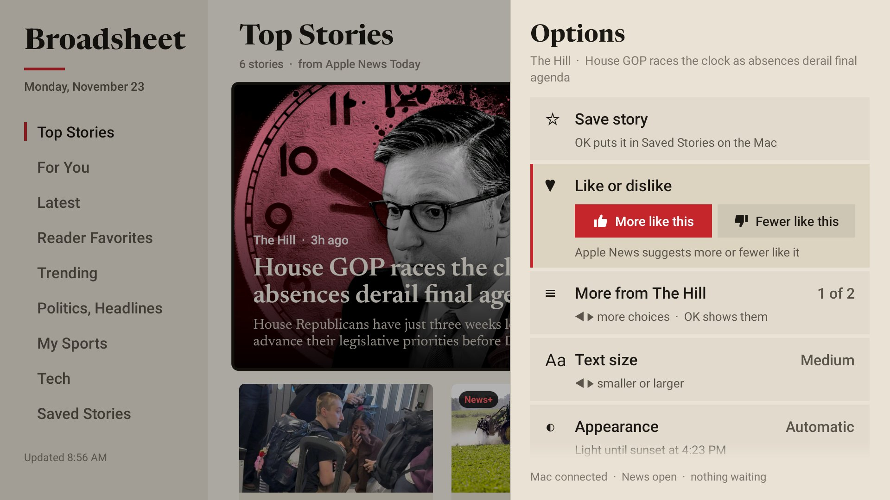
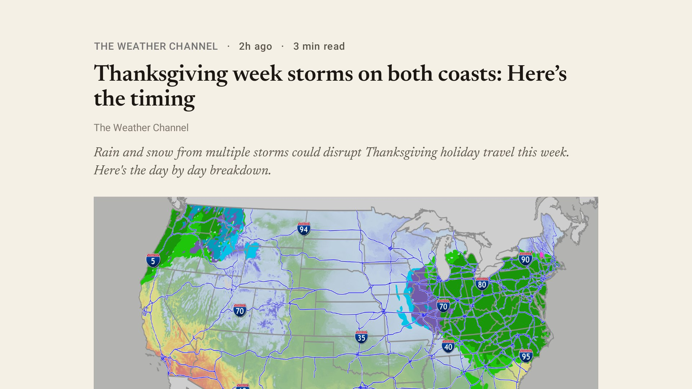
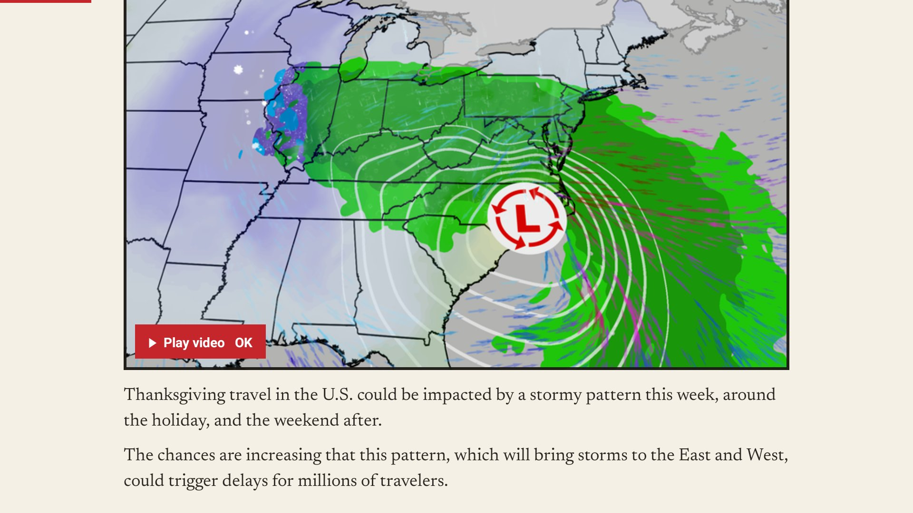
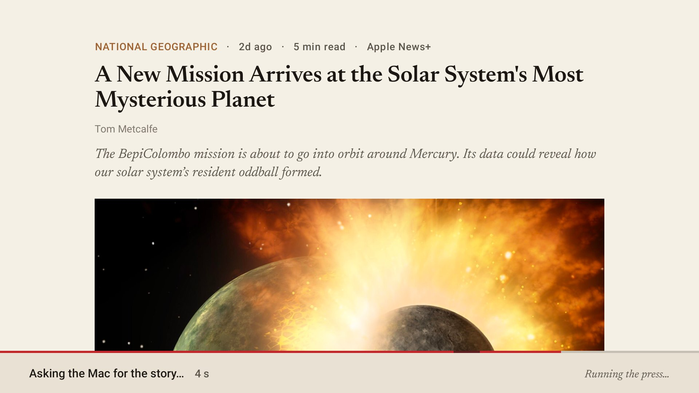

# Broadsheet: Apple News on Android TV and Fire TV

**A news reader for the TV, built for the remote.** Broadsheet shows your Apple News (Today's
Top Stories, For You, Trending, your topics and channels, Saved Stories) on an Android TV or
Fire TV, and reads whole articles in a calm, newspaper-style reader. No ads, no touch, no
account on the TV.

Apple News has no Android app and no reader API, so Broadsheet gets the news from
[**Apple News Relay**](https://github.com/VladislavEkimtcov/apple-news-relay), a small server
that runs on your Mac and turns the News app into a local JSON API. The TV finds the relay on
your network by itself.


- **Front page:** a rail of sections on the left; a hero story, two briefs and rows of picture
  cards. Moving along the rail skims sections; cached pages open instantly. The hero's words sit
  over its picture: the card measures how light the picture is under them (after its shade) and,
  where light type would fade into it, sets each line on a dark block.
- **Reader:** a single column of serif type (Newsreader, SIL OFL), pictures with captions, quotes
  and subheads. The headline, summary and picture show at once; the body follows, fetched from
  Apple News on the Mac if it wasn't there yet (usually in a quarter of a second). While it's on
  its way, a band at the bottom says what the Mac is doing, with a running bar and the press room
  at work ("Inking the plates…"), and grey lines wait where the text will be set. Resting on a
  card for a moment, or reading a story, has the Mac fetch that story or the next one ahead.
  Reopening a story goes back to where you left it.
- **Video:** a story's video is selected when it scrolls into view; OK plays it full screen,
  streamed straight from the publisher (Left/Right 10 s, OK pause, Back to the story).
- **Options (☰ Menu):** a panel slides in from the right, over the front page or a story, in the
  rail's square style. It acts on the story being read, or on the focused card:
  - **On the Mac** (like Handoff): when you're reading a story in Apple News on the Mac, or were
    in the last half hour, it's at the top of the panel; OK carries on with it on the TV.
  - **Save story** to Saved Stories on the Mac, or take it out again.
  - **Mark as unread** (or as read): a story read on the TV stops being dimmed or hidden.
  - **Like or dislike**: Apple News's *Suggest More / Fewer Stories Like This*. OK on the same one
    takes it back.
  - **More from** the publisher, **More on** one of the story's topics, or **Related stories**,
    as a new section at the top of the rail. The Mac loads more of the channel in the background.
  - **Text size** on a slider of ten steps, from 14 pt for close reading to 40 pt for across the
    room (the column widens for the big sizes), **Appearance** (automatic, dark, light), **Stories you've read**
    (show, dim or hide them), **Continue reading** the last unfinished story, **Refresh now** and
    how often to refresh by itself.
  - The footer says whether the Mac is answering and how much it has to do.
- **Light by day, dark at night:** in Automatic, the page turns light at sunrise and dark at
  sunset. The TV works out both offline from its time zone (the USNO sunrise equation, as dumbtv's
  quick settings do), with no location permission.
- **D-pad only:** Down/OK reads on (OK at the end opens the next story), Up goes back, Left/Right
  the previous/next story, Fast-forward/Rewind a page, Menu the options, Back the front page.
- **No ads:** the relay removes ad slots, sponsored stories and publisher promotions.
- **Apple News+:** whole stories when the Mac's account has Apple News+; otherwise the opening,
  clearly marked.
- **Light on a small TV box:** one view per card, pictures decoded at the size shown and dropped
  when far off screen, nothing animating at rest (0 frames and about 1 ms of CPU a second while
  idle, measured on the TV, panel open or not).
- **Private:** what you read, how far, and your likes stay on the TV (`library.json` in the app's
  files). The Mac only learns what the TV asks of it.






| | |
|---|---|
|  |  |

## Setup

1. On the Mac, run Apple News Relay for your network:
   ```sh
   git clone https://github.com/VladislavEkimtcov/apple-news-relay.git && cd apple-news-relay
   python3 -m apple_news_relay serve --host 0.0.0.0 --allow 127.0.0.1,192.168.1.0/24
   ```
2. Install Broadsheet on the TV (see [Build](#build)), open **News**. It finds the relay with
   Bonjour (`_newsrelay._tcp`), and where Bonjour doesn't get through (common between Wi-Fi and
   wired networks, or with a VPN app on the TV) by asking port 8787 on its own subnet. Until it
   finds one it tries again every 30 seconds; OK tries at once.

If the relay runs on another port or subnet, point the app at it by hand: put a `relay.conf` in
the app's files folder

```
url=http://192.168.1.20:8787
# token=...   if the relay was started with --token
```

```sh
adb push relay.conf /sdcard/Android/data/io.github.vladislavekimtcov.broadsheet/files/relay.conf
```

## Windows

[`windows/`](windows/README.md) has a Windows desktop port of Broadsheet: the same front page,
reader and options, with mouse, touchpad and keyboard. It's a single `Broadsheet.exe` that
builds and runs on a bare Windows 10/11 (IoT Enterprise LTSC included) with what ships in the
box (.NET Framework 4.8, MSBuild 4.0, C# 5): `windows\build.cmd`.

## Build

No Gradle, no libraries: the bare Android SDK and JDK 17.

```sh
./build.sh                          # build/broadsheet.apk, signed with release.keystore (made on first run)
adb install -r build/broadsheet.apk
```

`build.sh` needs `platforms;android-25` and any build-tools (34 tested). Keep `release.keystore`
(it's git-ignored): updates must be signed with the same key. Banner: `python3 tools/art.py`
(Pillow). Fonts: `python3 tools/fonts.py` (fontTools).

Sunrise and sunset have a test that runs on the computer:

```sh
javac -d build/test src/io/github/vladislavekimtcov/broadsheet/Sun.java tests/SunTest.java
java -cp build/test io.github.vladislavekimtcov.broadsheet.SunTest
```

## How it talks to the relay

| | |
|---|---|
| front page | `GET /v1/sections?per_section=30`, `GET /v1/articles?limit=45` (Latest), `GET /v1/saved` |
| a story | `GET /v1/articles/{id}`: the body, or the job fetching it (queued or running) |
| still fetching | `GET /v1/jobs/{id}?wait=12` (up to four times), then the article again |
| ahead of time | `POST /v1/articles/{id}/fetch?priority=background`: the card resting in focus, the next story |
| save, unsave | `PUT` / `DELETE /v1/saved/{id}?wait=25` |
| like, dislike, take back | `PUT /v1/articles/{id}/reaction?reaction=like` / `DELETE` the same |
| more like this | `GET /v1/channels/{id}/articles`, `/v1/topics/{id}/articles`, `/v1/articles/{id}/related`; then `POST /v1/channels/{id}/refresh` |
| freshness | `POST /v1/today/refresh?pages=4` every 25 minutes (or hourly, or never), then a quiet reload |
| On the Mac | `GET /v1/handoff` |
| the panel's footer | `GET /v1/status` |

Video plays from the URL in the story's `video` block, straight from the publisher's CDN.

The last front page is kept on disk, so the app opens instantly and still works for a while if
the Mac sleeps.

## Requirements

Android 7.1 (API 25) or later with a D-pad remote: Fire TV Stick and Cube, Fire TV smart TVs,
Google TV, Android TV. Built and tuned on a Fire OS 8 (Android 11) TV with a MediaTek MT5896.

## License

MIT. Fonts: Newsreader by Production Type, SIL Open Font License 1.1 (`assets/fonts/OFL.txt`).
Not affiliated with Apple or Amazon. Stories belong to their publishers.
