# Broadsheet for Android: Apple News on Android phones and TVs

**Apple News on Fire TV, Android TV, Google TV and Android phones.** One APK: on a TV it's a
news reader built for the remote; on a phone or tablet, a touch reader. Broadsheet shows your
Apple News (Today's Top Stories, For You, Trending, your topics and channels, Saved Stories)
and reads whole articles in a calm, newspaper-style reader. No ads, no account on the device.

**[Download broadsheet.apk](https://github.com/VladislavEkimtcov/broadsheet/releases/latest/download/broadsheet.apk)**
(the latest release). The rest of Broadsheet, the Windows port and how releases are made:
[the main README](../README.md).

## On a phone

Apple News for Android phones and tablets (Android 7.1 or later), in the same newspaper style:

| | | |
|---|---|---|
| 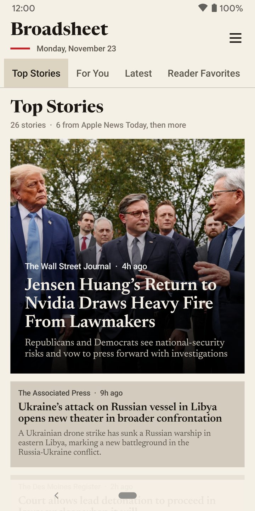 | 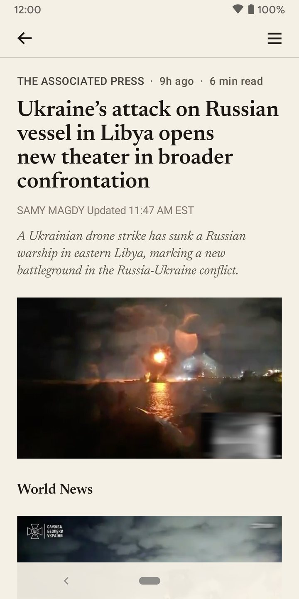 | 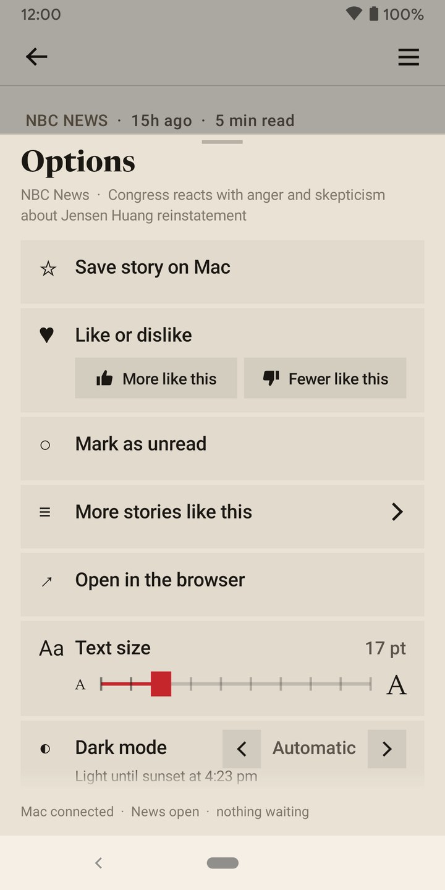 |

- **Front page:** a masthead with ☰, the sections as a strip along the top that scrolls
  sideways (the chosen one lit, with the red bar at its foot), and a gallery-style pager over
  each section in one column (two in landscape or on a tablet): hero, briefs, picture cards.
  Swipe left or right anywhere on the page to slide between categories, tap a story to read it,
  long-press it for its options. Deep sections load more as you scroll; pull down to refresh.
  The last front page shows at once when the app starts; if the Mac isn't answering, a note
  says so and what's there stays readable.
- **Reader:** the TV's serif column, as wide as the screen allows. Scroll and fling with a
  finger, swipe sideways for the previous or next story, ← or Back for the front page. It
  reopens where you left off; the text size goes from 14 to 40 pt (17 to start).
- **Video:** tap it; it plays full screen. Tap to pause, tap the line to seek, Back to close.
- **Options (☰):** a sheet from the bottom with everything the TV has (On the Mac, save, mark
  as unread, like or dislike, more from, text size, appearance, read stories, continue reading,
  refresh), plus Open in the browser and **Relay address**: leave it empty and the phone finds
  the relay by itself, or type the Mac's address (`192.168.1.20` means
  `http://192.168.1.20:8787`).
- Light by day, dark after sunset, like the TV; the status bar and gesture bar follow.

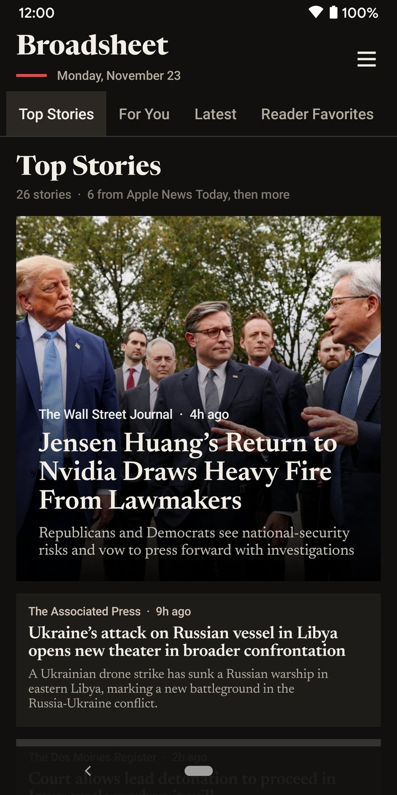

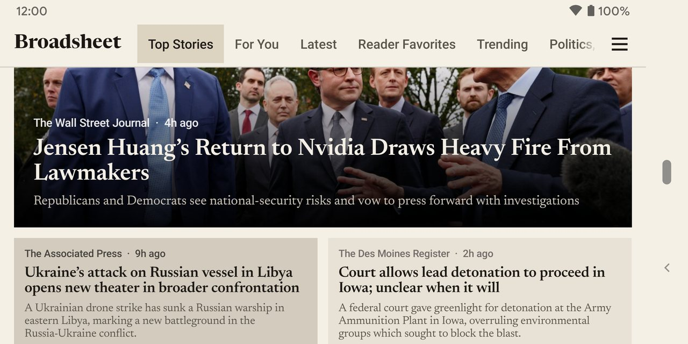

## On a TV

Apple News has no Android app and no reader API, so Broadsheet gets the news from
[**Apple News Relay**](https://github.com/VladislavEkimtcov/apple-news-relay), a small server
that runs on your Mac and turns the News app into a local JSON API. The TV finds the relay on
your network by itself.

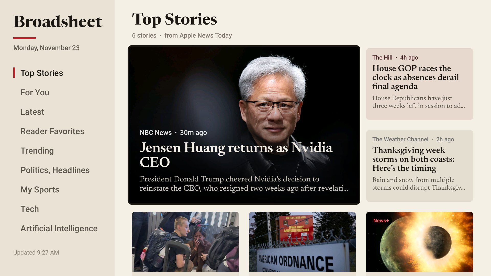

- **Front page:** a rail of sections on the left; a hero story, two briefs and rows of picture
  cards. Moving along the rail skims sections; cached pages open instantly. The hero's words sit
  over its picture: the card measures how light the picture is under them (after its shade) and,
  where light type would fade into it, sets each line on a dark block.
- **Reader:** a single column of serif type (Newsreader, SIL OFL), pictures with captions, quotes
  and subheads. The headline, summary and picture show at once; the body follows, fetched from
  Apple News on the Mac if it wasn't there yet (usually in a quarter of a second). While it's on
  its way, a band at the bottom says what the Mac is doing, with a running bar and the press room
  at work ("Inking the plates…"), and grey lines wait where the text will be set. Resting on a
  card for a moment, or reading a story, has the Mac fetch that story or the next one ahead.
  Reopening a story goes back to where you left it.
- **Video:** a story's video is selected when it scrolls into view; OK plays it full screen,
  streamed straight from the publisher (Left/Right 10 s, OK pause, Back to the story).
- **Options (☰ Menu):** a panel slides in from the right, over the front page or a story, in the
  rail's square style. It acts on the story being read, or on the focused card:
  - **On the Mac** (like Handoff): when you're reading a story in Apple News on the Mac, or were
    in the last half hour, it's at the top of the panel; OK carries on with it on the TV.
  - **Save story on Mac** to Saved Stories on the Mac, or **Unsave story on Mac** to take it out again.
  - **Mark as unread** (or as read): a story read on the TV stops being dimmed or hidden.
  - **Like or dislike**: Apple News's *Suggest More / Fewer Stories Like This*. OK on the same one
    takes it back.
  - **More stories like this ›** opens a pop-up with **More from** the publisher, **More on** one
    of the story's topics and **Related stories** (each fetched as Options opens), and shows the
    one you pick as a new section at the top of the rail. The Mac loads more of the channel in the background.
  - **Text size** on a slider of ten steps, from 14 pt for close reading to 40 pt for across the
    room (the column widens for the big sizes), **Dark mode** (automatic, dark, light), **Stories you've read**
    (do nothing, dim after reading or hide after reading), **Continue reading** the last unfinished story, **Refresh now** and
    how often to refresh by itself, and **Updates** (release builds watch GitHub Releases quietly,
    verify and stage `broadsheet.apk`, and show a non-intrusive notice to install when ready).
  - The footer says whether the Mac is answering and how much it has to do.
- **Light by day, dark at night:** in Automatic, the page turns light at sunrise and dark at
  sunset. The TV works out both offline from its time zone (the USNO sunrise equation, as dumbtv's
  quick settings do), with no location permission.
- **D-pad only:** Down/OK reads on (OK at the end opens the next story), Up goes back, Left/Right
  the previous/next story, Fast-forward/Rewind a page, Menu the options, Back the front page.
  On the front page Back steps out: from a story to its section on the rail, then to the top of
  the rail; Back there leaves the app.
- **No ads:** the relay removes ad slots, sponsored stories and publisher promotions.
- **Apple News+:** whole stories when the Mac's account has Apple News+; otherwise the opening,
  clearly marked.
- **Light on a small TV box:** one view per card, pictures decoded at the size shown and dropped
  when far off screen, nothing animating at rest (0 frames and about 1 ms of CPU a second while
  idle, measured on the TV, panel open or not).
- **Private:** what you read, how far, and your likes stay on the TV (`library.json` in the app's
  files). The Mac only learns what the TV asks of it.

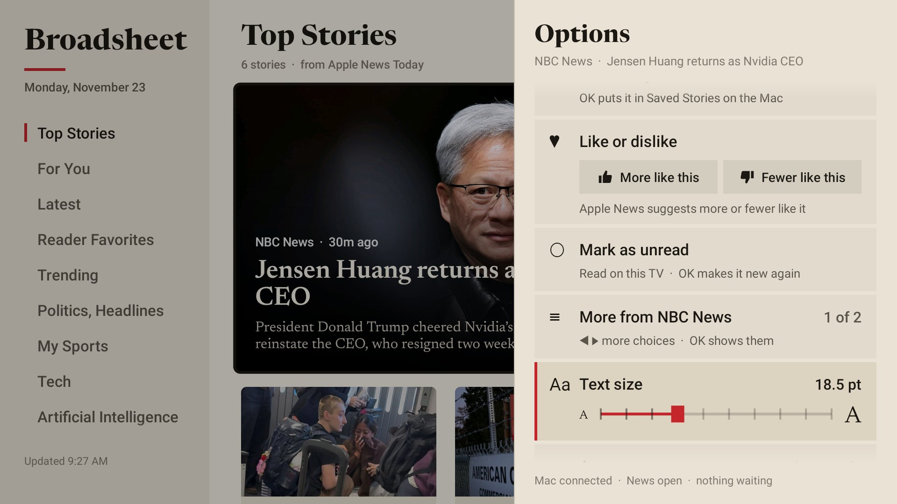

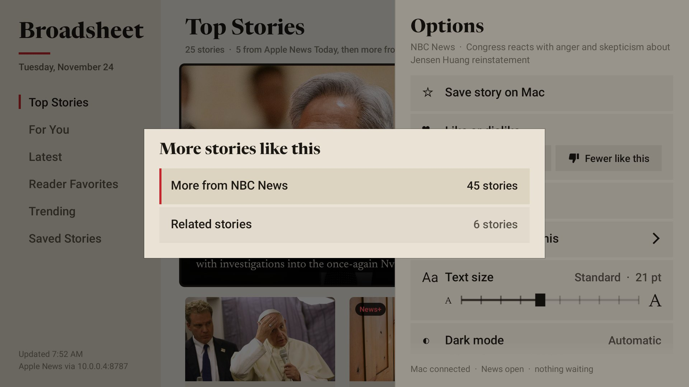

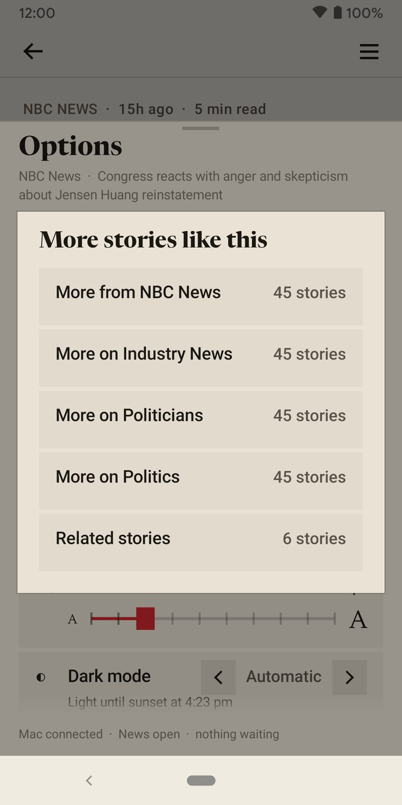

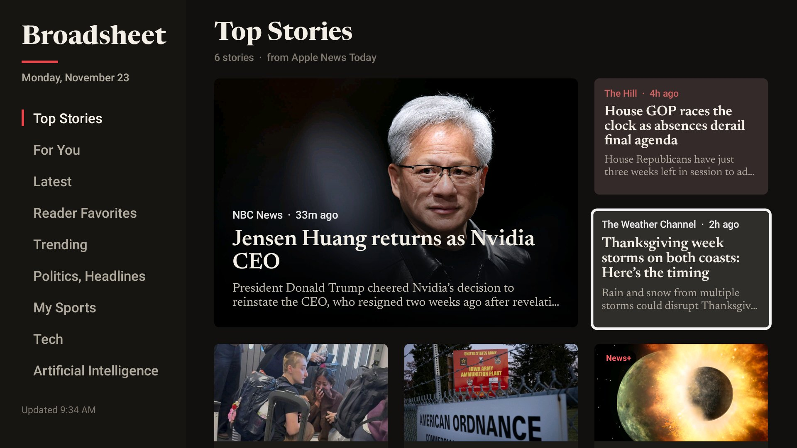

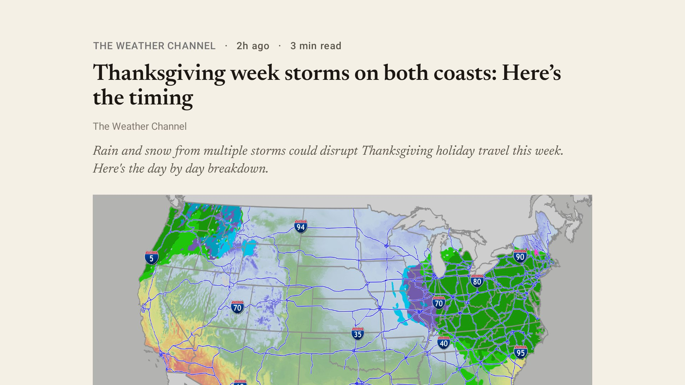

| | |
|---|---|
| 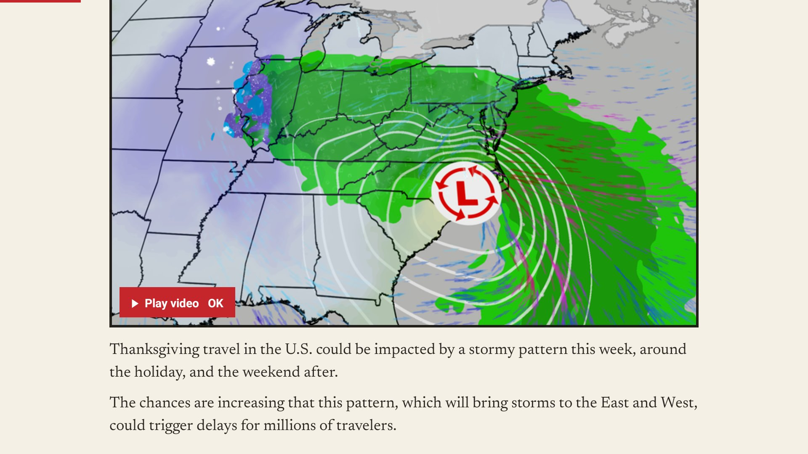 | 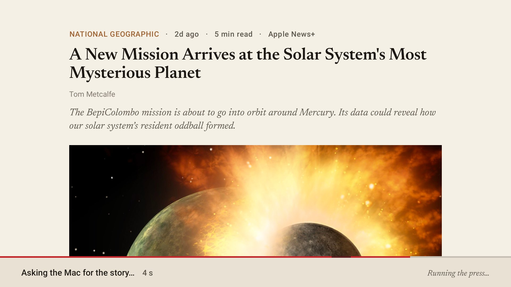 |

## Setup

1. On the Mac, run Apple News Relay for your network:
   ```sh
   git clone https://github.com/VladislavEkimtcov/apple-news-relay.git && cd apple-news-relay
   python3 -m apple_news_relay serve --host 0.0.0.0 --allow 127.0.0.1,192.168.1.0/24
   ```
2. Install `broadsheet.apk` on the TV (sideload it with Downloader or `adb install -r
   broadsheet.apk`, or [build it](#build)), open **Broadsheet**. It finds the relay with
   Bonjour (`_newsrelay._tcp`), and where Bonjour doesn't get through (common between Wi-Fi and
   wired networks, or with a VPN app on the TV) by asking port 8787 on its own subnet. Until it
   finds one it tries again every 30 seconds; OK tries at once.

If the relay runs on another port or subnet, point the app at it by hand: **Options → Relay
address** (the last entry; on the TV, OK brings up the keyboard; empty goes back to finding it
by itself). That writes a `relay.conf` in the app's files folder, which you can also push

```
url=http://192.168.1.20:8787
# token=...   if the relay was started with --token
```

```sh
adb push relay.conf /sdcard/Android/data/io.github.vladislavekimtcov.broadsheet/files/relay.conf
```

## Build

No Gradle, no libraries: the bare Android SDK and JDK 17.

```sh
cd android
./build.sh                          # build/broadsheet.apk, signed with ../release.keystore (made on first run)
AUTO_UPDATE=1 ./build.sh            # enable background GitHub Releases update checks (set in CI releases)
adb install -r build/broadsheet.apk
./test.sh                           # the shared cases in ../spec/cases on the JVM
python3 ../tools/parity.py          # PARITY.md against every front end's code
```

`build.sh` needs `platforms;android-25` and any build-tools (34 tested; `BUILD_TOOLS=34.0.0`
picks one). The version comes from `../version.env`, shared with the Windows port. Keep
`release.keystore` (it's git-ignored): updates must be signed with the same key. With
`KEYSTORE=` set, or `CI` set, `build.sh` never makes a new key. Releases are built and signed by
GitHub Actions; the certificate they must carry is pinned in `signing-cert.sha256`. Banner:
`python3 ../tools/art.py` (Pillow). Fonts: `python3 ../tools/fonts.py` (fontTools).

Sources, one Java package in three roots: `src/` is shared by the TV and the phone (relay
client, the controller `Main`, reader, options panel, player, cards), `tv/src/` is the TV's
front page with its rail, `phone/src/` the phone's. The launcher activity `.Main` decides at
start: a TV (UI mode television, or no touchscreen) gets the TV UI in landscape; anything else
the touch UI (`Ui.touch`), which also switches the shared reader, options and player to their
touch modes.

## How it talks to the relay

| | |
|---|---|
| front page | `GET /v1/front`: every section (its first 12 stories), Latest and Saved in one call, with `If-None-Match`; `304` when nothing changed |
| more of a section | the section's `links.next` (`GET /v1/sections/{id}/articles?cursor=…`), 15 at a time, as focus nears the end |
| live | `GET /v1/events`: `hello` on connecting, `front.updated` (reload once the remote is still), `article.body_captured`, `job.updated` |
| a story | `GET /v1/articles/{id}?wait=14&max_chars=2400`: one trip, the Mac fetching it if needed; the first couple of screens |
| the rest of it | `GET /v1/articles/{id}?fetch=never&from_block=N`, when the reader is within two screens of the loaded end |
| still fetching | `GET /v1/jobs/{id}?wait=12` (rarely: only when 14 s weren't enough), then the article again |
| ahead of time | `PUT /v1/interest/{client}`: the stories around the card in focus, a section's first three when resting on it on the rail, the next stories while reading (the relay has Apple News fetch them; the newest list replaces the last); `DELETE` when the app goes to the background |
| openings ahead | `GET /v1/articles/{id}?fetch=never&max_chars=2400` for the ones the relay already has, kept on the TV |
| save, unsave | `PUT` / `DELETE /v1/saved/{id}?wait=25` |
| like, dislike, take back | `PUT /v1/articles/{id}/reaction?reaction=like` / `DELETE` the same |
| more like this | `GET /v1/channels/{id}/articles`, `/v1/topics/{id}/articles`, `/v1/articles/{id}/related`; then `POST /v1/channels/{id}/refresh` |
| freshness | `POST /v1/today/refresh?pages=4` every 25 minutes (or hourly, or never); the page follows on `front.updated` |
| On the Mac | `GET /v1/handoff` |
| the panel's footer | `GET /v1/status` |

A relay older than 0.3 gets the 0.2 calls: `/v1/sections`, `/v1/articles`, `/v1/saved`, and
`POST /v1/articles/{id}/fetch?priority=background` for one story at a time.

Video plays from the URL in the story's `video` block, straight from the publisher's CDN.

On the TV, kept in the app's cache folder: the last front page (so the app opens at once and
still works for a while if the Mac sleeps), stories opened or headed for (`bodies/`, 8 MB, 400
stories, two weeks, the least recently opened first out), and pictures (`img/`, 150 MB). Cards
fetch the picture size they show (750 px wide for a tile, not 2048).

## Requirements

Android 7.1 (API 25) or later: phones and tablets with a touchscreen, and TVs with a D-pad remote: Fire TV Stick and Cube, Fire TV smart
TVs, Google TV, Android TV; built and tuned on a Fire OS 8 (Android 11) TV with a MediaTek
MT5896.

## License

MIT. Fonts: Newsreader by Production Type, SIL Open Font License 1.1 (`assets/fonts/OFL.txt`).
Not affiliated with Apple or Amazon. Stories belong to their publishers.
